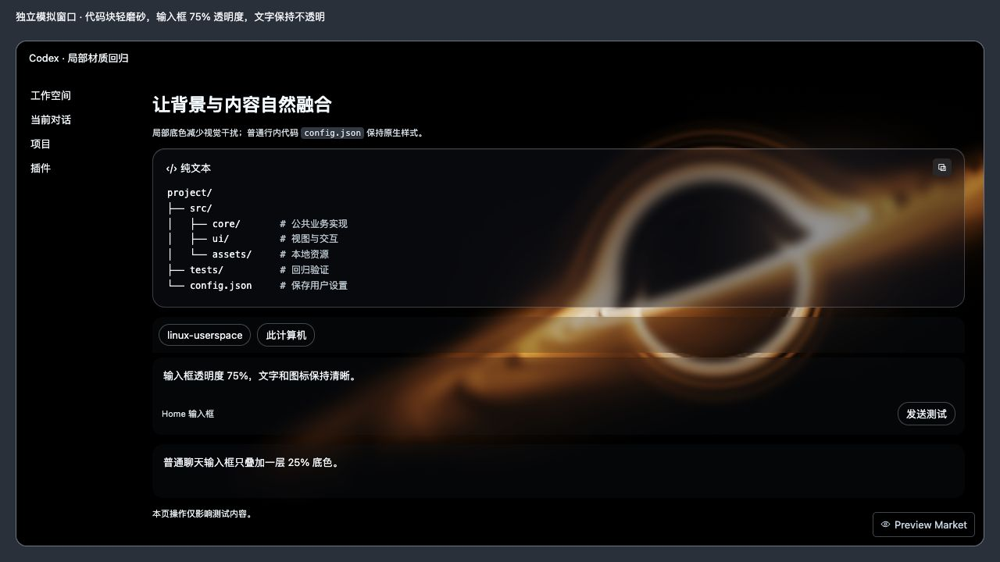

# Code-Codex Mac

**本项目 fork 自 Windows 版 [Rice-dog/code-codex](https://github.com/Rice-dog/code-codex)，是其外观组件的非官方 macOS 移植。** 上游由 Rice-dog 与 Code-Codex contributors 维护；本项目保留上游署名、MIT License 和第三方来源声明。

移植基线为上游固定提交 [`6cef54643bb4b446f4bd81f2e3fa5f576629f674`](https://github.com/Rice-dog/code-codex/tree/6cef54643bb4b446f4bd81f2e3fa5f576629f674)。背景渲染模块、Preview Market 外观界面及参数定义沿用该 Windows 版本；macOS 的 Swift 启动器、Dock 安装与卸载、局部材质和性能适配在本项目中实现。

本仓库是独立创建的 macOS 移植仓库，按发布需要整理源码；这里的 fork 指代码来源与衍生关系。移植范围集中在动态背景与外观控制，未包含上游完整 Git 历史、Windows 安装器及文件管理功能。本项目与 OpenAI 无关，也不代表上游作者的官方 macOS 发布。

这是 **Dock 单击启动器＋应用内外观扩展**。安装后点击 Dock 的「GPT 动态背景」，直接打开带背景的官方 GPT，不再先进入管理器点击启动，也不需要终端。原来的官方 GPT 入口继续保留，采用普通启动。启动器不修改官方应用文件、签名、登录凭据或聊天记录。

当前版本 `1.0.0-rc.8` 为 Dock 启动版候选。原生目标约束与组件校验可自动测试；实际 GPT 接入需用户完成任务、完全退出后亲自启动验收，不能把构建通过当成正式稳定版证明。

## 使用

1. 解压并双击 **Code-Codex Mac.app**，尚未安装的副本会显示安装页。
2. 点击 **安装 / 修复 Dock 入口**，安装到 `~/Applications/Code-Codex Mac.app`，并在官方 GPT 图标旁加入「GPT 动态背景」。完成后安装页退出。
3. 首次切换入口时，完成当前任务，按 **Cmd+Q** 完全退出正在运行的 GPT。
4. **点击一次 Dock 的「GPT 动态背景」**。启动器直接打开官方 GPT，自动启用上次选择的背景；首次使用默认为黑洞。
5. GPT 窗口内 **Preview Market → Appearance** 选择背景，**Mac 设置**调节性能和材质。菜单栏 **✦** 提供安装与设置、恢复、卸载和退出。

重复点击已管理会话的 Dock 入口会打开现有 GPT 窗口，不启动第二个进程。如果 GPT 从普通入口打开，启动器会提示先完成任务并完全退出，不会替用户关闭聊天。以后双击新版安装包并点击安装，会在固定位置升级，旧版本不另占一个应用入口。安装前检查完整版本、渠道、背景清单和资源；失败保留上一版，成功后清理已确认的旧副本。正在运行的安装来源退出后移入废纸篓，背景参数保留。普通更新不允许公开四背景包覆盖个人八背景包。安装完成后的普通启动不会弹出管理器窗口；只有菜单栏 **安装与设置…** 才打开设置窗口。

输入框默认 75% 透明度，代码块默认轻磨砂，文字保持 100% 不透明度。侧栏、项目、消息和输入文字固定白色加 0.55px 黑边，亮暗主题和背景动画都不再使同一段文字黑白跳变；链接、代码语法和状态保留各自颜色。设置分组卡片完全透明，小控件用固定暗色底保证标签清晰，保留开关及禁用状态。

运行时不再读取背景像素或为弹窗复制 WebGL 画面。均衡模式将复杂背景限制在 30 帧、200 万像素，轻量效果最高 60 帧；失焦降到 15 帧，隐藏时暂停。画质优先继续提供 60 帧与更高像素预算；节能进一步压低背景像素。低帧率使用定时唤醒，避免仍在每个显示刷新周期执行回调。所有分辨率调整只作用于装饰背景，文字和控件不缩放。



上图为独立模拟预览，不能代替实际 GPT 窗口验收。

公开包包含黑洞、发光地平线、层叠山峦与闪烁方块。极光、天境云、云海列车和银河的再分发证据尚未齐全，因此未放进公开仓库和公开构建；用户本机的个人安装包保留八个背景及其参数面板，使用当前适配代码；公开下载包与本机个人包的清单不同。见 [LICENSE_STATUS.md](LICENSE_STATUS.md)。

## 恢复和卸载

- 应用内 **Mac 设置 → 恢复原生外观** 或菜单栏 **✦ → 恢复当前窗口外观**可移除接入的主题。
- 菜单栏 **✦ → 卸载 GPT 动态背景…** 会移除本启动器的 Dock 入口、已注册的配套说明插件和启动器，将应用移入 macOS 废纸篓；官方 GPT、其他 Dock 项目、聊天与背景参数保留。
- 正常退出 GPT，再从原来的应用图标打开，可关闭临时本机调试端点。退出后台启动器会停止为新窗口接入，已打开窗口中的效果可通过其自身恢复按钮移除。

## 接入边界

当前[官方插件文档](https://developers.openai.com/plugins/build/plugins)与[扩展能力列表](https://developers.openai.com/plugins/build/extensions)支持插件工具及其 UI、设置等功能，没有公开提供本项目所需的全窗口主题注入接口。本地管理器使用只绑定 `127.0.0.1` 的临时 CDP；核验 OpenAI Team ID `2DC432GLL2` 与官方签名，只接受同一进程端点的 `app://-/index.html`。该运行期间其他本机进程可能连接调试端点，结束后普通重启关闭。没有设置远程监听、关闭安全检查或自动重启已有应用。

这是独立原生启动器，背景与控制面板由它接入 GPT。配套说明插件为可选的操作指南，原生安装不依赖插件注册或下载；源码中的 plugin.json 与 .agents 目录可供 Codex CLI / 插件目录单独安装。安装说明插件不能自动让原 GPT 图标加载主题。Chat / Work 模式未验证；应用升级后容器结构可能需要适配。

## 构建

Apple Silicon，macOS 13+，构建需要 Xcode Command Line Tools 和 Node >=22.13；运行生成的应用不需要 Node。

```sh
npm test
npm run build

# 独立主题 / 光标 / 设置卡片回归页面（输出链接可切换 /contrast、/settings、/conversation 与 /performance）
node scripts/preview.mjs
```

交付 ZIP 和 SHA256SUMS 输出到 `dist/`，解压 ZIP 后即可安装。构建中的 `.app` 放在 `.build/artifacts.noindex/public/`，避免应用搜索再次出现同名构建副本。构建、签名和 ZIP 校验成功后才替换候选并清理同渠道旧 ZIP；失败仍保留上一份可用包。可设置 `CODE_CODEX_SIGN_IDENTITY` 用 Developer ID 签名；公开面向普通用户发布还需要 Apple notarization。目前本地候选仅 ad-hoc 签名，未做 notarization，不应宣称通过 Gatekeeper 的公开发行版。

构建会运行原生启动决策、重复点击、Dock 添加与移除模型、安装/更新目标约束和本机模拟 WebSocket 测试，不会修改测试机器的 Dock，也不会启动、关闭或连接正在运行的 GPT。验证边界及稳定版发布条件见 [VERIFICATION.md](VERIFICATION.md)。

运行包使用 Swift 原生启动器，不打包 Node、Electron 或官方 GPT 副本。只有被选中的背景模块运行；后台启动器在接入完成后每 10 秒检查新窗口，不建立登录启动项。安装会登记用户 Dock 的应用入口，卸载按安装路径移除自己的项目；不会用旧备份覆盖用户之后调整的 Dock 排列。

## 许可与归属

保留上游 MIT License 及完整来源声明，不声称对第三方作品拥有权利，也不表示 OpenAI 或上游作者的背书。适配器、原生管理器与原创集成修改在可分离部分适用 MIT；其他条款见 [THIRD_PARTY_NOTICES_EN.md](THIRD_PARTY_NOTICES_EN.md) 和 [THIRD_PARTY_LICENSES.md](THIRD_PARTY_LICENSES.md)。
